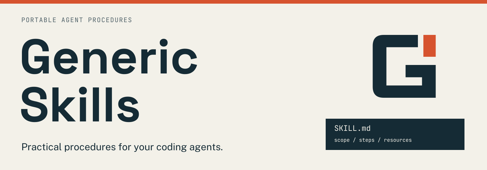

# Generic Skills



A portable collection of 48 agent skills for software development, review,
debugging, research, and writing. Each skill includes the references and helpers
its entrypoint uses. Choose skills individually for the work you do.

## Install

Clone this repository and copy selected directories from `skills/` into your
agent's skill directory. For Codex, that directory is `~/.codex/skills/`:

```sh
git clone https://github.com/PatrickFanella/generic-skills.git
mkdir -p ~/.codex/skills
cp -R generic-skills/skills/systematic-debugging ~/.codex/skills/
```

Copy the complete skill directory so its references and scripts stay together.
Review an existing installation before replacing it. Other agents can use the
same `SKILL.md` files when they support that format; tool availability and
invocation behavior depend on the client. Skills do not grant permission to
publish, deploy, delete, or change external services.

## Included skills

- [`api-development`](skills/api-development/SKILL.md)
- [`architecture-patterns`](skills/architecture-patterns/SKILL.md)
- [`auth-implementation-patterns`](skills/auth-implementation-patterns/SKILL.md)
- [`ci-maintenance`](skills/ci-maintenance/SKILL.md)
- [`cli-developer`](skills/cli-developer/SKILL.md)
- [`clonedeps`](skills/clonedeps/SKILL.md)
- [`cloudflare-deploy`](skills/cloudflare-deploy/SKILL.md)
- [`code-review`](skills/code-review/SKILL.md)
- [`codemap`](skills/codemap/SKILL.md)
- [`codemod-surgeon`](skills/codemod-surgeon/SKILL.md)
- [`database-migration`](skills/database-migration/SKILL.md)
- [`dependency-upgrade`](skills/dependency-upgrade/SKILL.md)
- [`frontend-design`](skills/frontend-design/SKILL.md)
- [`gdpr-data-handling`](skills/gdpr-data-handling/SKILL.md)
- [`git-advanced-workflows`](skills/git-advanced-workflows/SKILL.md)
- [`gitea-repo-overhaul`](skills/gitea-repo-overhaul/SKILL.md)
- [`golang-pro`](skills/golang-pro/SKILL.md)
- [`implementation-plan`](skills/implementation-plan/SKILL.md)
- [`llm-evaluation`](skills/llm-evaluation/SKILL.md)
- [`mcp-builder`](skills/mcp-builder/SKILL.md)
- [`mcp-integration-lifecycle`](skills/mcp-integration-lifecycle/SKILL.md)
- [`mtls-configuration`](skills/mtls-configuration/SKILL.md)
- [`observability`](skills/observability/SKILL.md)
- [`performance-investigation`](skills/performance-investigation/SKILL.md)
- [`playwright`](skills/playwright/SKILL.md)
- [`postgres-pro`](skills/postgres-pro/SKILL.md)
- [`prototype`](skills/prototype/SKILL.md)
- [`python-development`](skills/python-development/SKILL.md)
- [`rag-implementation`](skills/rag-implementation/SKILL.md)
- [`react-pro`](skills/react-pro/SKILL.md)
- [`refactor`](skills/refactor/SKILL.md)
- [`repository-delivery-review`](skills/repository-delivery-review/SKILL.md)
- [`requirements-interview`](skills/requirements-interview/SKILL.md)
- [`rust-pro`](skills/rust-pro/SKILL.md)
- [`secrets-management`](skills/secrets-management/SKILL.md)
- [`security-best-practices`](skills/security-best-practices/SKILL.md)
- [`security-ownership-map`](skills/security-ownership-map/SKILL.md)
- [`security-threat-model`](skills/security-threat-model/SKILL.md)
- [`session-handoff`](skills/session-handoff/SKILL.md)
- [`shell-development`](skills/shell-development/SKILL.md)
- [`systematic-debugging`](skills/systematic-debugging/SKILL.md)
- [`tdd`](skills/tdd/SKILL.md)
- [`technical-writing`](skills/technical-writing/SKILL.md)
- [`typescript-pro`](skills/typescript-pro/SKILL.md)
- [`unslop`](skills/unslop/SKILL.md)
- [`verify-behavior`](skills/verify-behavior/SKILL.md)
- [`wcag-audit-patterns`](skills/wcag-audit-patterns/SKILL.md)
- [`wizard`](skills/wizard/SKILL.md)

## Validation and CI

```sh
python3 -m pip install PyYAML==6.0.3
python3 scripts/validate.py
```

The validator checks entrypoints, local entrypoint links, licenses, the skill
inventory, and reviewed file hashes. It does not run every helper or establish
behavior across agent clients. Gitea runs package validation; the GitHub copy
has Actions disabled.

## Source and updates

The development source is [Generic Skills on Gitea](https://git.subcult.tv/subculture-collective/generic-skills).
GitHub receives its default branch through a conservative publishing mirror.
This repository starts with reviewed exported files and fresh history.

Changes here should remain useful outside a particular workstation, fleet, or
organization. Review changed resources, refresh the corresponding hashes in
`provenance.json`, and validate before publishing. The provenance manifest lists
the exported inputs and original license grants.

## License

Original repository packaging and original material without another grant use
[GPL-3.0-or-later](LICENSE). Imported skills retain their MIT or Apache-2.0 grants;
see each skill's license, bundled notices, and `provenance.json`. Those grants
are preserved. Bundled frontend data retains its separate MIT notice.

## Repository artwork

[Brand assets and usage](assets/brand/README.md).
