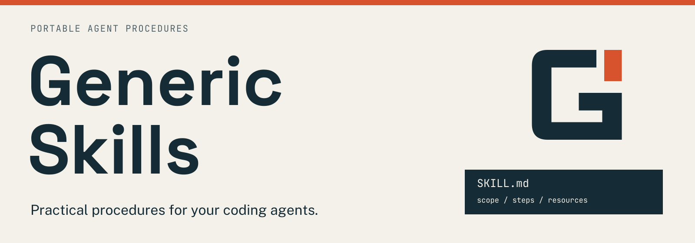

# Generic Skills



A portable collection of 48 agent skills for software development, review,
debugging, research, and writing. It is the public edition of patstack, the
SUBCULT agent skill stack, with workstation and organization specifics removed.
Each skill includes the references and helpers its entrypoint uses.

## Install

**With Subsets.** [Subsets](https://subsets.subcult.tv) offers this collection
on its first interactive run as the `patstack` pack. Accept the prompt, or add it
later with `subsets pack add patstack`. The skills arrive inactive, grouped as
`patstack`; turn them on with `subsets apply --group patstack`.

**From npm.** The package is `@subcult/patstack`. It installs nothing into
your agent directories by itself:

```sh
npm pack @subcult/patstack
tar -xzf subcult-patstack-*.tgz
cp -R package/skills/bug-tracer ~/.codex/skills/
```

**From the repository.** Clone it and copy the skill directories you want into
your agent's skill directory (for Codex, `~/.codex/skills/`). Copy a complete
directory so its references and scripts stay together, and review an existing
installation before replacing it. Other agents can use the same `SKILL.md`
files when they support that format; tool availability and invocation behavior
depend on the client. Skills do not grant permission to publish, deploy,
delete, or change external services.

## Included skills

- [`api-contract-smith`](skills/api-contract-smith/SKILL.md)
- [`auth-gatekeeper`](skills/auth-gatekeeper/SKILL.md)
- [`bash-script-craft`](skills/bash-script-craft/SKILL.md)
- [`behavior-proof`](skills/behavior-proof/SKILL.md)
- [`boundary-drafter`](skills/boundary-drafter/SKILL.md)
- [`bug-tracer`](skills/bug-tracer/SKILL.md)
- [`build-sequencer`](skills/build-sequencer/SKILL.md)
- [`bus-factor-map`](skills/bus-factor-map/SKILL.md)
- [`cf-edge-deploy`](skills/cf-edge-deploy/SKILL.md)
- [`ci-medic`](skills/ci-medic/SKILL.md)
- [`cli-contract-smith`](skills/cli-contract-smith/SKILL.md)
- [`dep-source-clone`](skills/dep-source-clone/SKILL.md)
- [`dep-upgrade-pilot`](skills/dep-upgrade-pilot/SKILL.md)
- [`diff-inspector`](skills/diff-inspector/SKILL.md)
- [`eval-bench`](skills/eval-bench/SKILL.md)
- [`git-surgery`](skills/git-surgery/SKILL.md)
- [`gitea-fleet-tidy`](skills/gitea-fleet-tidy/SKILL.md)
- [`go-craft`](skills/go-craft/SKILL.md)
- [`mcp-server-forge`](skills/mcp-server-forge/SKILL.md)
- [`mcp-wire-tracer`](skills/mcp-wire-tracer/SKILL.md)
- [`mtls-trust-chain`](skills/mtls-trust-chain/SKILL.md)
- [`perf-hotpath-probe`](skills/perf-hotpath-probe/SKILL.md)
- [`pg-plan-reader`](skills/pg-plan-reader/SKILL.md)
- [`playwright-cli-driver`](skills/playwright-cli-driver/SKILL.md)
- [`privacy-controls`](skills/privacy-controls/SKILL.md)
- [`prose-unslop`](skills/prose-unslop/SKILL.md)
- [`python-uv-workbench`](skills/python-uv-workbench/SKILL.md)
- [`react-render-tuner`](skills/react-render-tuner/SKILL.md)
- [`red-green-loop`](skills/red-green-loop/SKILL.md)
- [`relay-baton`](skills/relay-baton/SKILL.md)
- [`repo-atlas`](skills/repo-atlas/SKILL.md)
- [`retrieval-pipeline`](skills/retrieval-pipeline/SKILL.md)
- [`rust-ownership-async`](skills/rust-ownership-async/SKILL.md)
- [`safe-refactor-pass`](skills/safe-refactor-pass/SKILL.md)
- [`schema-migrator`](skills/schema-migrator/SKILL.md)
- [`scope-grill`](skills/scope-grill/SKILL.md)
- [`secret-rotation-flow`](skills/secret-rotation-flow/SKILL.md)
- [`secure-code-audit`](skills/secure-code-audit/SKILL.md)
- [`setup-wizard-script`](skills/setup-wizard-script/SKILL.md)
- [`ship-check`](skills/ship-check/SKILL.md)
- [`stride-threat-map`](skills/stride-threat-map/SKILL.md)
- [`sweep-rewriter`](skills/sweep-rewriter/SKILL.md)
- [`tech-doc-writer`](skills/tech-doc-writer/SKILL.md)
- [`telemetry-signal-forge`](skills/telemetry-signal-forge/SKILL.md)
- [`throwaway-prototype`](skills/throwaway-prototype/SKILL.md)
- [`ts-type-design`](skills/ts-type-design/SKILL.md)
- [`ui-craft`](skills/ui-craft/SKILL.md)
- [`wcag-a11y-audit`](skills/wcag-a11y-audit/SKILL.md)

## Validation and CI

```sh
python3 -m pip install PyYAML==6.0.3
python3 scripts/validate.py
```

The validator checks entrypoints, local entrypoint links, licenses, the skill
inventory, and reviewed file hashes. It does not run every helper or establish
behavior across agent clients. Gitea runs package validation; the GitHub copy
has Actions disabled.

## Source and updates

The skills are exported from patstack by its `scripts/public-edition.py`, which
applies the reviewed substitutions and refuses an export that still contains
host names, private paths or account names. Change a skill in patstack, then
export it here; edits made only in this repository are overwritten by the next
export.

The development source is [Generic Skills on Gitea](https://git.subcult.tv/subculture-collective/generic-skills).
GitHub receives its default branch through a conservative publishing mirror.
This repository starts with reviewed exported files and fresh history.

Changes here should remain useful outside a particular workstation, fleet, or
organization. Review changed resources, refresh the corresponding hashes in
`provenance.json`, and validate before publishing. The provenance manifest lists
the exported inputs and original license grants.

## Releases

A `v*` tag matching `package.json` validates the tagged commit, packs it once and
publishes that tarball as `@subcult/patstack` to the Gitea npm registry and public
npm, then attaches it to a Gitea release (`.gitea/workflows/release.yml`). Public
npm needs the repository secret `NPM_TOKEN`. "Run workflow" with publish off
checks the package and both registry logins without publishing.

## License

Original repository packaging and original material without another grant use
[GPL-3.0-or-later](LICENSE). Imported skills retain their MIT or Apache-2.0 grants;
see each skill's license, bundled notices, and `provenance.json`. Those grants
are preserved. Bundled frontend data retains its separate MIT notice.

## Repository artwork

[Brand assets and usage](assets/brand/README.md).
